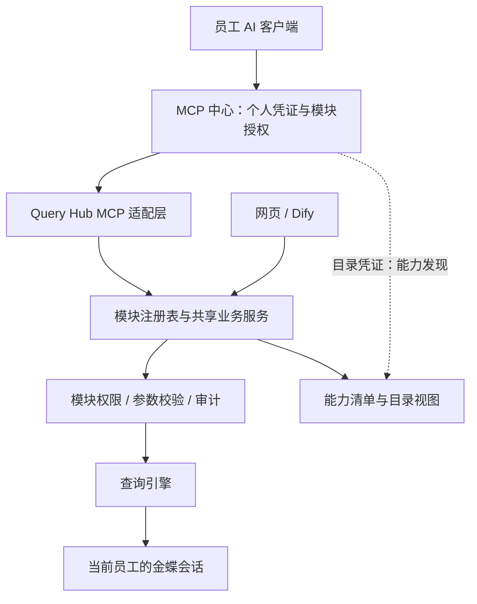

# Query Hub 模块化 MCP 与统一中心接入技术方案

- 日期：2026-11-10
- 状态：设计稿，未实施；本文的新增接口、配置和目录均为建议契约。
- 范围：Kingdee Query Hub 与 Chency MCP Center。
- 目标：现有及未来业务模块共享 MCP 接入机制，员工保持一个连接器地址，能力按员工权限动态提供。

## 1. 设计决策

1. Query Hub 提供一个 MCP 服务入口，每个业务模块注册一个或多个具名工具。
2. 用模块注册表统一描述操作、参数、返回口径、权限和发布状态；MCP 不维护独立的业务查询实现。
3. 网页、Dify、MCP 通过共享业务服务执行查询、权限校验和审计。
4. 中心一次性登记 `queryhub` 系统，此后通过认证的能力清单同步模块和工具，不再逐个修改工具白名单代码。
5. 自动发现不等于自动授权。新增能力先进入待审核目录，发布与员工开通分别管理。
6. 第一版只发布只读查询和已具备的详情能力，写操作、自动审批、任意 SQL、任意金蝶接口不在范围内。
7. 初期采用部署后重新加载注册表，不引入运行时加载任意代码或插件热更新。

## 2. 当前实现与差距

| 所属项目 / 文件 | 当前职责 | 改造点 |
| --- | --- | --- |
| Query Hub `config/query-catalog.json` | 模块数据源、筛选字段、公开字段、部分权限属性 | 保留数据源定义，补齐操作契约；不把金蝶内部字段公开为模型参数 |
| Query Hub `src/catalog.js` | 生成页面目录，单独追加审批进度 | 从统一注册表生成目录，审批进度成为正式注册模块 |
| Query Hub `src/query-engine.js` | 标准查询及复杂模块分派 | 继续复用，逐步将分派封装为注册的处理函数 |
| Query Hub `server.js` | HTTP 路由、查询、详情、权限和审计组合 | 抽取无 Express 依赖的共享业务服务 |
| Query Hub `src/access-control.js` | 模块名单与敏感模块控制 | 继续作为本地权限权威；新增权限版本号供目录缓存失效 |
| Query Hub `src/auth.js` | 网页 / Dify 身份认证 | 新增独立 MCP 委托认证，不能直接复用允许调用方传用户名的 Dify 入口 |
| Center `src/store.ts` | 固定系统、固定 toolScopes、员工授权 | 为 Query Hub 引入动态、版本化能力映射和模块授权 |
| Center `src/discovery.ts` | 分页读取 tools/list，保存工具快照 | 同步能力清单，原子校验，加入差异分类和审批 |
| Center `src/mcp.ts` | 按固定 toolScopes 聚合和转发工具 | 动态映射，并与上游员工可用工具取交集 |

中心当前目录变更会进入 pending，但首次发现可直接成为 healthy；本方案对 Query Hub 的首次发布也要求审核。当前发现最多 100 个工具、10 页、约 1 MB，未来扩展需要明确上限与分页，不能静默丢弃超额工具。

## 3. 总体架构



中心负责连接器身份、开通、审核目录和调用路由；Query Hub 负责模块能力、参数、业务权限、数据口径与执行。金蝶继续执行实际业务对象、组织与数据权限。

## 4. 模块与操作注册契约

建议新增目录（均为待实施）：

```text
src/modules/registry.js           注册、唯一性校验、目录生成
src/modules/definitions/          每个模块的公开操作定义
src/services/query-service.js    统一查询、详情、权限与审计
src/mcp/server.js                MCP 协议适配
src/mcp/auth.js                  服务认证与委托上下文核验
src/mcp/identity.js              员工到金蝶身份的映射
src/mcp/manifest.js              能力清单与版本生成
src/mcp/result.js                标准结果转换
```

模块注册示例（说明结构，不是可直接运行的实现）：

```js
registerModule({
  id: 'inventory',
  title: '即时库存',
  category: 'inventory',
  sensitivity: 'internal',
  catalogKey: 'inventory',
  operations: {
    query: {
      toolName: 'inventory_query',
      scope: 'queryhub:inventory:read',
      readOnly: true,
      inputSchema: inventoryQuerySchema,
      outputSchema: queryResultSchema,
      handler: inventoryQueryHandler,
      publication: 'enabled',
      contractVersion: 1,
    },
  },
});
```

### 4.1 参数约束

- 每个操作给出 JSON Schema，明确类型、必填项、枚举、长度和上下界；对象默认 `additionalProperties: false`。
- 日期不仅验证字符串格式，还验证真实日期、起止顺序及模块最大期间。
- 需要筛选条件的模块明确“至少提供一项有效条件”，不能用空字符串绕过。
- limit、aggregation、仓库范围、账龄阈值等特殊参数逐模块定义，不从字段名称猜测。
- 禁止输入用户身份、原始过滤表达式、任意字段、任意 WebAPI 方法；已有审批 formId 仅允许服务端配置的白名单值。
- Schema 校验在服务端真实执行；工具描述和 readOnlyHint 仅作为提示，不承担授权。

### 4.2 注册校验

启动时检查模块 ID、工具名唯一、引用的数据源和处理函数存在、权限范围非空、Schema 有效、输出契约完整。无效定义使该次部署健康检查失败，避免发布半套目录。

工具名称使用 `{moduleId}_{operation}`，中心加 `queryhub_` 前缀。定义工具名长度上限时包含中心前缀，并按目标客户端兼容性验证。

复杂查询继续复用现有算法；标准模块可使用通用查询处理函数。新增复杂业务仍需实现算法，但无需新增 MCP 路由或中心工具分派代码。

## 5. 工具与能力清单接口

### 5.1 MCP 入口

建议入口 `/api/mcp/`，采用与中心 SDK 兼容的 Streamable HTTP，锁定依赖版本并验证协议协商。由官方 SDK 处理初始化、JSON-RPC 和协议错误，不自行拼装一套简化协议。

该路由挂载在网页 `/api` 认证路由之前；使用独立认证，不要求浏览器 Cookie，不被 SSO 重定向到 HTML 登录页。只对该精确路径配置所需代理例外，保留服务凭证验证、来源限制和 TLS。

优先无状态请求处理；如果 SDK 版本需要会话，仍然每次请求重新验证员工及授权，不把初始化时权限长期固定在会话中。

两类身份：

| 身份 | tools/list | tools/call |
| --- | --- | --- |
| 目录凭证 | 已启用、可申请发布的完整定义，不含业务数据 | 永远拒绝 |
| 中心服务凭证 + 已验证员工委托 | 员工有效权限内的工具 | 重新校验后执行 |

### 5.2 私有能力清单

建议新增 `GET /internal/mcp/v1/manifest`，只允许目录凭证。它是中心与业务系统之间的私有契约，不是新增 MCP 标准方法。

清单至少包含：

- `schemaVersion`：清单格式版本。
- `systemId`：固定为 `queryhub`。
- `revision`：规范化清单与工具定义的内容摘要。
- `modules`：模块标识、名称、分类、敏感级别、操作列表。
- 每个操作的工具名、scope、契约版本、只读属性和定义摘要。
- `tools`：与目录凭证 tools/list 相同的公开工具定义。

manifest 在一个响应内携带完整的工具定义，供中心原子入库；分页 tools/list 用于协议发现与兼容性核对。同步期间版本变化则重试，不混合不同版本。当前规模保留大小限制，超限明确报错；未来如引入清单分页，必须绑定同一 revision。

权限映射来自受认证且经审核的清单，不能因工具自行声明 readOnly 或 scope 就自动增加授权。

## 6. 身份与权限链路

### 6.1 调用步骤

1. 中心验证员工个人凭证、目录新鲜度、系统开通和模块 scope。
2. 中心使用 Query Hub 专用服务凭证转发请求，传入已验证的 `X-Chency-MCP-User` 和 `X-Chency-MCP-Delegated: 1`，不转发个人统一凭证。
3. Query Hub 先校验服务凭证，再向中心现有 `/internal/v1/delegated-context` 核验该员工对 `queryhub` 的实时范围。
4. 将可信员工身份映射到唯一有效的金蝶用户；校验模块和操作权限。
5. 使用该员工金蝶身份执行查询，生成结果与审计。

中心不可用、员工离职、目录过期、映射缺失或存在歧义时拒绝业务调用；不能回退管理员、共享账号、旧凭证或请求体声明的身份。沿用中心既有员工生命周期和凭证策略，不另设固定日历有效期。

### 6.2 身份映射

中心 business_username 与本项目 kingdeeUsername 不能假定相同。建立服务端映射记录，绑定稳定员工标识、中心账号、金蝶用户标识及用户名。使用可信目录字段构建候选映射，由唯一性验证或管理员核对后生效；不能只靠重名中文姓名自动匹配。员工身份替换、禁用、金蝶用户更名时使相关缓存失效。

### 6.3 权限交集

有效能力 = 中心当前系统资格 ∩ 员工已开通 scope ∩ 中心经审核目录 ∩ Query Hub 已启用操作 ∩ Query Hub 模块名单。

数据结果继续受金蝶权限和模块本人范围限制。中心管理员身份不会自动转化为 Query Hub 超级管理员身份。详情查询必须重新校验父模块及目标对象权限，不能仅凭已知单据号读取。

### 6.4 工具发现与实时撤销

中心对 tools/list 获取上游员工视图，与已审核快照、当前 grants 取交集。第一版不跨请求缓存个人可用目录；可缓存静态工具定义，禁止以其他员工目录作为失败回退。

tools/call 再次验证，不能依赖先前 tools/list。撤销后下一次调用被拒绝；已开始执行的只读事务允许结束。客户端可能缓存工具列表，提供刷新/重连指引；服务端撤销生效不能依赖客户端刷新或变更通知。

## 7. 中心目录、授权与发布生命周期

### 7.1 数据结构建议

保留现有其他系统的固定配置，新增 Query Hub 动态提供者，避免一次性改写所有服务。

建议新增或扩展以下逻辑表：

- capability_revisions：system、revision、完整规范化清单、pending/approved 状态、审核人和时间。
- capability_tools：revision、module、tool、required_scope、definition_hash。
- module_access_rules：system、module、人员/岗位申请规则。
- grants：继续存实际 scope 数组，新增模块不得通过通配符自动加入历史授权。

一次事务发布同一 revision 的工具定义和权限映射，不能先更新工具再更新 scope。

### 7.2 变更处理

| 变更 | 行为 |
| --- | --- |
| 第一次接入、新模块、新工具、新 scope | 待审核；审核后允许申请/开通 |
| 参数、结果契约、描述或权限语义变化 | 产生新版本并展示差异，审核后发布 |
| 工具删除、模块停用 | 业务端立即拒绝，中心成功同步后立即收缩可用目录 |
| 发现失败 | 保留最后审核定义供管理查看，员工发现/执行不能跳过实时上游核验 |
| 不兼容契约变化 | 新工具版本或明确升级迁移，旧客户端调用返回可理解错误 |

审批等待期间，只继续提供定义摘要仍匹配当前上游的旧工具。发生契约变化的工具暂时隐藏并拒绝调用，避免中心按旧定义展示而上游按新定义执行。上游在执行前校验中心传入的已审核定义摘要（私有请求头契约），防止发现与调用之间的版本竞争；摘要不能替代身份认证。

### 7.3 用户体验

中心增加“金蝶查询”系统卡，卡内按模块查看、开通和注销。申请资格规则沿用中心人员/岗位体系，模块可以进一步收紧；业务数据权限仍由 Query Hub 管理。

第一版可按模块 read scope 授权，同模块 query/detail 共享 read scope；新模块需显式开通。新操作仍需目录审核，未来写操作使用新的独立 scope 和确认流程，不能复用 read scope。

## 8. 统一业务执行与返回结果

共享服务建议签名：`executeOperation({ identity, moduleId, operation, arguments, requestContext })`。requestContext 只提供来源、请求标识和审计信息，不要求 Express req/res。

先迁移现有 query、费用详情、经营分析详情，再让网页、Dify、MCP 调用同一服务。保持现有 HTTP 返回结构，MCP 在外层转换，避免改变前端行为。

MCP 成功结果同时提供 `structuredContent` 和简短文本摘要，至少描述：

| 内容 | 要求 |
| --- | --- |
| 模块、操作、契约版本 | 可追踪结果含义 |
| 生效条件与统计期间 | 返回服务端实际采用的范围 |
| columns / rows | 公开字段，不包含内部数据源配置 |
| returnedCount / sourceReadCount | 区分展示条数与实际读取条数；未知值不能编造 |
| completeness | complete / partial / unknown，并附原因 |
| aggregationScope | 全量、已读取集合或不适用 |
| grain / units / currency | 数据粒度、金额和数量口径 |
| queriedAt / requestId | 查询时间与审计关联 |

现有结果达到行数上限只能证明“可能不完整”时，适配层保守标记，不能自行声称全量。没有明确币种或单位时返回未知或模块说明，不能默认所有金额都是人民币。

不同模块保留自己的读取上限和聚合策略，不统一强加普通查询 200 行规则。响应增加字节预算，超限明确说明；不静默截断后仍返回完整标志。第一版不承诺所有模块都支持分页；后续游标必须绑定员工、查询条件和版本。

错误区分未认证、无权限、参数无效、目录待审核、身份未映射、上游不可用、查询范围过大。协议错误交由 SDK；业务工具失败返回 isError 和可操作的业务说明，不泄露令牌、原始 SQL、内部地址和堆栈。

## 9. 当前模块覆盖计划

| 模块 ID | 第一版操作 | 备注 |
| --- | --- | --- |
| inventory | query | 至少一个有效筛选条件 |
| inventory_cycle | query | 仓库阶段、周期条件逐项声明 |
| sales_orders | query | 订单头粒度 |
| sales_business_analysis | query、detail | 复用现有详情路径，校验同模块权限 |
| project_pur_sale_consistency | query | 保留系统报表粒度和原始业务口径 |
| overdue_receivables | query | 发票账龄口径 |
| receivable_aging | query | 应收账龄口径 |
| overdue_risk_combined | query | 明确双口径合并规则 |
| purchase_orders | query | 订单头粒度 |
| supplier_purchase_analysis | query | 保留期间限制与汇总口径 |
| personnel_cost | query | 严格保留敏感模块限制 |
| expense_claims | query、detail | 保留现有本人范围和既有授权例外 |
| workflow_progress | query | 正式纳入注册表，保留本人发起范围 |

第一版预计 15 个工具，实际以契约评审为准。账龄明细、导出、内置 AI 分析作为后续独立操作评估，不能仅因为引擎有内部函数就自动暴露。

## 10. 配置、运维与审计

建议新增配置：MCP_ENABLED（默认关闭）、MCP_DIRECTORY_TOKEN、MCP_SERVICE_TOKEN、MCP_CENTER_INTERNAL_URL、MCP_CENTER_SERVICE_TOKEN、MCP_MAX_RESPONSE_BYTES、MCP_QUERY_TIMEOUT_MS。名称在实现时统一确认。

目录认证、中心到 Query Hub 调用、Query Hub 到中心核验按方向/用途隔离；不得复用 Dify Key。中心已有的服务认证机制可以扩展，但必须明确凭证受众和轮换行为。

按员工和模块限制并发、频率及查询期间；业务超时应短于中心转发超时，并尽可能取消上游请求。中心当前上游默认超时为 120 秒，实施时核对部署配置，不将长查询直接扩展为无限等待。

Query Hub 记录员工映射标识、模块、操作、来源、请求 ID、授权结论、脱敏筛选摘要、耗时、条数和完整性；不记录原始业务行和凭证。中心记录工具、员工、结果和耗时，避免中心与业务端对同一次请求重复计数。工资等敏感筛选进一步脱敏。

健康检查覆盖注册表有效性、必要配置及服务就绪状态；不得为了健康检查运行真实业务数据查询。中心故障状态和上游查询故障分别展示。

## 11. 实施顺序

1. **基础重构**：建立注册表和共享服务；现有网页 / Dify 回归通过。
2. **最小联通**：完成 MCP 认证、身份映射、结果适配；使用库存、费用报销和一个复杂分析模块验证。
3. **中心接入**：登记 queryhub，完成清单同步、目录审核、模块 scope、员工目录交集及调用时版本校验。
4. **完整覆盖**：登记全部当前模块，迁移审批进度特殊目录，补齐数据口径和敏感权限验证。
5. **扩展验证**：增加仅测试环境使用的新模块，证明中心无需改代码即可发现、审核、授权及调用。
6. **灰度启用**：先使用不同权限的测试员工验证，再按模块逐步开放。

新增模块开发流程固定为：定义数据源/算法 → 注册操作契约 → 定义权限与敏感级别 → 编写模块文档和针对性测试 → 本地验证 → 提交部署 → 中心同步审核 → 员工开通。无需修改 MCP 主路由、中心工具分派或客户端地址。

## 12. 测试与验收

| 类别 | 必须验证 |
| --- | --- |
| 协议 | 中心真实 SDK 初始化、分页发现、合法调用、错误调用及协议版本协商 |
| 注册 | 重名、无处理函数、无 scope、无效 Schema 被阻止发布 |
| 身份 | 伪造员工头、目录令牌调用业务、服务令牌缺失、身份歧义均拒绝 |
| 权限 | 两名不同权限员工工具列表不同；直接猜工具名与单据号不能绕过；敏感模块无默认授权 |
| 撤销 | 中心注销、岗位变化、本地名单移除后下一次调用拒绝，已有会话不保留旧权限 |
| 契约 | 新增进入待审核；定义变更期间不能旧目录新执行；清单版本原子发布 |
| 数据 | 网页 / Dify / MCP 相同用户和条件得到等价业务结果，完整性和合计口径一致 |
| 扩展 | 测试新模块只改 Query Hub 定义及实现，中心无需改源码、客户端无需换地址 |
| 故障 | 中心不可用、上游超时、目录超限、响应过大、发现期间部署变化有明确结果 |
| 回归 | 现有登录、权限管理、详情、查询、AI 分析与审计保持有效 |

使用虚构数据做自动测试，不把真实员工、业务明细或凭证提交到仓库。Query Hub 运行 npm run check；中心按其项目规范运行测试、构建和依赖审计。生产验证使用明确具备权限的员工身份，服务健康不等于员工调用验证完成。

## 13. 部署、回滚与完成标准

本地开发验证后，两项目分别经 SSH Git remote 提交并推送。部署目标按实际网络和项目部署规范确认，设计文档不固化环境密钥或地址。

顺序：先部署默认关闭且向后兼容的 Query Hub 能力，再部署中心动态提供者和数据库迁移，配置内部连通与凭证，完成测试员工验证、目录审核和模块灰度。实施前备份权限及中心授权数据，迁移优先采用增加表/列方式。

回滚优先禁用中心 queryhub 和 Query Hub MCP 功能开关，保持网页与 Dify 运行。必要时回滚应用版本，避免回滚数据库导致已撤销凭证或授权复活；恢复备份按中心现有恢复与凭证撤销规则处理。

完成标准：当前模块已按计划覆盖；未来新模块能够按注册约定接入；授权员工可发现和调用；无权限员工不可发现且不可直接调用；撤销下一次生效；结果口径可核对；员工连接器配置保持不变。

## 14. 实施前需要核实的环境事实

- 中心员工稳定标识与金蝶用户唯一标识的可用字段及映射质量。
- 部署环境中两项目的内部 TLS、网络可达性和反向代理规则。
- 中心当前 SDK 与目标客户端的 Streamable HTTP、结构化结果、目录刷新兼容性。
- 当前各模块特殊参数、上限、本人范围例外的完整契约。

这些属于实施时的核实事项，不改变本方案的模块化方向。具体权限名单、凭证值和生产数据不进入设计文档。

## 15. 参考

- 本项目 README.md、docs/modules/README.md 及各模块说明。
- 本项目 src/catalog.js、src/query-engine.js、src/auth.js、src/access-control.js、server.js。
- 中心 src/store.ts、src/discovery.ts、src/mcp.ts、src/app.ts；现有委托认证和目录审批逻辑。
- [MCP 工具规范（2025-11-25，兼容性参考）](https://github.com/modelcontextprotocol/modelcontextprotocol/blob/main/docs/specification/2025-11-25/server/tools.mdx)。
- [MCP 传输规范（2025-11-25，兼容性参考）](https://github.com/modelcontextprotocol/modelcontextprotocol/blob/main/docs/specification/2025-11-25/basic/transports.mdx)。

协议参考版本不代表必须升级或降级现有中心；最终使用经中心 SDK 与客户端联调验证的协商版本。
